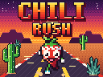

# Chili Rush

[](https://github.com/chili-chip/chili-rush/actions/workflows/build.yml)



A fast pseudo-3D endless runner for the ChiliChip **VGC Zero** (RP2350, 128x128), built on the [chili-chip fork of the 32blit SDK](https://github.com/chili-chip/32blit-sdk). It also runs on desktop (SDL) and in the browser: [play it on the web](https://chili-chip.github.io/chili-rush/).

A little chili sprints down an endless highway. Switch lanes, jump the low things, slide under the signs and dodge the tall ones. Grab chilis to build your combo and fill the heat bar, then set yourself on fire and smash through everything.

## Controls

| Button | Action |
|---|---|
| D-pad left / right | Change lane |
| A or D-pad up | Jump (press in the air to queue the next jump) |
| B or D-pad down | Slide (in the air: drop fast and slide on landing) |
| Y or X | Fire dash, when the heat bar is full |
| MENU | Pause |

On a PC: arrow keys or WASD, `Z` = A, `X` = B, `C` = X, `V` = Y, `Esc` or `2` = MENU.

## How it plays

- **Obstacles.** Low ones (fence, food cart, lava rock, tumbleweed): jump. The tumbleweed rolls across the road and now and then stops right on a line of chilis, so you have to jump it or leave the line. Signs and arches: slide under. Parked cars and the volcano's spires: change lane. A parked car's headlights may be off, dipped, on full beam or flashing. Every row of obstacles leaves a way through, and rows are always far enough apart to reach it.
- **Chilis** score points and fill the heat bar. Picking them up in a row builds a combo: every 10 adds +1 to the multiplier (up to +4). Missing a chili resets the combo.
- **Close calls.** Change lane at the last moment past an obstacle for bonus points and heat.
- **Golden chili** fills the heat bar at once. **Milk** is a shield that takes one hit. The **sombrero** is a magnet for 10 seconds.
- **Fire dash** (Y when the heat bar is full): 4 seconds of extra speed, you cannot be hit and you smash obstacles for points.
- **Biomes.** The road goes from the desert at sunset to a neon city at night and into a volcano, then round again. It gets faster the further you run.
- **Shop (STYLE).** Every chili you collect goes into your wallet. STYLE on the title screen spends them: up/down picks an obstacle, left/right shows its four colour schemes, Y (or X) shows its second look, and A buys what is shown. The first colour is free; the others cost 200, 400 and 800 chilis, and a new look costs 2500 (hay bales, roadworks, bone pile, ranch gate, sky bridge, rib arch, camper van, taxi, crystals, old tyre). Anything not bought goes back when you leave. Saves from before the shop start with every chili you ever collected in the wallet and keep the colours already picked.
- **Big moments.** A new best, a new biome and 100, 200, 500, 1000, 2000 and 5000 chilis in one run set the bottom of the screen on fire, with hit markers, bouncing text and an air horn; a close call gets a smaller burst.
- **Moves.** Now and then the jump is a dab (a one-leg hop, a dab at the top, arms windmilling down) and the slide a knee slide.
- **Start of a run.** PLAY starts with a short camera move: a close-up of the chili, the shades go on, and the camera swings round behind it. Any button skips it; restarts go straight to the countdown.
- **Missions.** Three missions at a time (collect chilis, run a distance, jump, slide, close calls, combos, dashes). Every 3 completed missions give a star, and each star adds +1 to your base score multiplier.

Best score, totals, missions, the music and sound settings, the chili wallet, what you bought and the obstacle colours and looks are saved.

Testing on the console: press X on the title screen to show the frame rate and how long a frame takes to draw.

## Build

Like the other ChiliChip games; see the [SDK docs](https://sdk.chilichip.eu/). The SDK is expected next to this folder (`../32blit-sdk`) or in `PATH_32BLIT_SDK`.

```bash
# desktop (Linux: libsdl2-dev libsdl2-image-dev libsdl2-net-dev; pip install 32blit "bitstring<5")
cmake -B build -D32BLIT_DIR=../32blit-sdk
cmake --build build
./build/chili-rush.elf

# VGC Zero (.uf2)
cmake -B build-vgc -D32BLIT_DIR=../32blit-sdk -DPICO_SDK_PATH=../pico-sdk -DPICO_BOARD=chilichip_vgc \
  -DPICO_PLATFORM=rp2350-arm-s -DCMAKE_TOOLCHAIN_FILE=../32blit-sdk/pico2.toolchain
cmake --build build-vgc
```

### Self-test

`-DCHILI_SELFTEST=ON` (off by default, desktop only) also builds `chili-rush-selftest`, a headless test of the real game code with no window or sound:

```bash
cmake -B build-test -D32BLIT_DIR=../32blit-sdk -DCHILI_SELFTEST=ON
cmake --build build-test --target chili-rush-selftest
./build-test/chili-rush-selftest           # 24 seeds, about 8000 s of play (3 min on 4 cores)
./build-test/chili-rush-selftest --quick   # 4 seeds, what CI runs
```

- **Fairness.** A bot that plans its moves (lane changes, jumps, slides, the jump buffer, fire dash) plays many seeds, from the first metre to top speed. Alongside, the test tracks every state a player could be in by now with any inputs (one every 0.05 s) and reports any obstacles that no inputs at all could survive, rechecked with an input every 10 ms. It must catch a hand-made wall of three blocks and pass the tightest fair rows.
- **Every update:** the object pool never fills, no chili inside an obstacle, no power-up inside a row, no NaN, score, combo, multiplier and heat stay sane, popups stay clear of the HUD, and the bot's model of the runner matches the game exactly.
- **Flows:** the countdown, pause and resume, every way out of a run (crash, restart, quit, the console quitting the game) counting the run once with its chilis, best and missions, the results screen ignoring a held or mashed A, obstacles readable from far enough at top speed, the title demo never touching the save, damaged saves, the shop (buying, too few chilis, the wallet filling once per run, old saves, every look drawn), catching up after a long stall, distances 200 km into a run, and text that must fit 128 px.

It prints a summary and exits 1 on any failure (`-v` shows details, `--jobs N` sets the processes). `--frames DIR` renders fixed scenes (every biome, dash, magnet, shield, the shop, every bought look, the big-moment effects, crash, results, pause) to images, `--clip DIR [--clip-from M]` renders 5 seconds of a run frame by frame (to compare changes to the look in motion; `--clip-from -1` starts from the title with the intro; `--clip-bot` lets the planning bot steer, as for the website GIF; `--clip-frames N` sets the length), and `--bench` times the renderer.

CI builds Linux, macOS, Windows, the web version, and the VGC `.uf2` and `.blit` on every push, and the Linux job runs the self-test. Publishing a GitHub release attaches all builds; a push to `main` deploys the web version to GitHub Pages.

## Code

| File | What it does |
|---|---|
| `game.cpp` | Game states, the road renderer, world generation, collisions, HUD and menus |
| `audio.cpp`, `audio.hpp` | Music sequencer and sound effects on the 32blit audio channels |
| `sprites.hpp` | Where each sprite sits in `assets/sprites.png` |
| `selftest.hpp`, `selftest_main.cpp` | The self-test (`-DCHILI_SELFTEST=ON`) and its headless stand-in for the console |
| `tools/make_sprites.py` | Draws `assets/sprites.png`, `assets/splash.png` and `assets/icon.png`, and writes `paint.hpp` |
| `paint.hpp` | Generated: the obstacle colours the STYLE menu changes, and the headlight colours |

Saves: slot 0 holds the score, totals and missions, slot 1 the chosen colours and slot 2 the shop (wallet, bought colours and looks). Each has its own magic number, so a save from an older version keeps working.

The road is drawn one screen row at a time: a row `y` below the horizon shows the road at depth `z = FOCAL / (y - HORIZON)`. Bends shift each row sideways by `curve * z²`, and sprites are scaled by their depth. `FOCAL` works like the camera's lens: a long lens (200) keeps obstacles far down the road big enough to tell apart, and the self-test checks that a fence 0.45 s away at top speed is at least 7 px wide. Objects fade in at the far end instead of popping up.

Obstacle colours cost nothing to draw: the sprite sheet is paletted, every colour of a paintable obstacle is a palette entry of its own (`tools/make_sprites.py` nudges shared colours by a step the 16-bit screen cannot show), and the STYLE menu rewrites those entries. An obstacle's second look uses the same entries, so one colour choice paints both looks. Headlights are switched the same way for each car as it is drawn. It needs no 3D engine, which keeps it fast on the RP2350.

## Licence

Code, art and music: [MIT](LICENSE), © 2026 ChiliChip. All art and music were made for this game.
